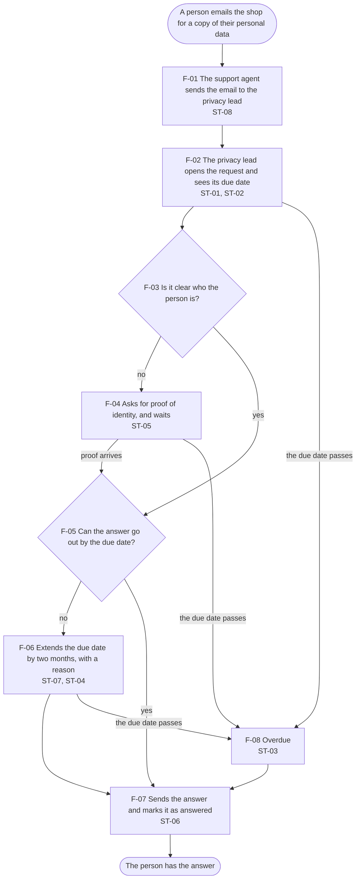

# product-spec

A set of files that hold everything a product knows that an agent cannot find in the code, and scripts that check the product against them.

- **The spec** is a folder of text files, in two levels. The product level says who the users are, the official rules, the product decisions and the business rules. The feature level says the steps of each task and what each screen shows in each situation.
- **The checks** are scripts. They check that the spec is complete, that the built screen does what the spec says, and that the screen uses the design system correctly.
- **The handoff** is a file written by a script from the spec, for anyone who builds from it: the rules, the steps of the task, the screen's states and one acceptance test per case.

It is one source with several readers. AI tools build the product from it, a synthetic user reviews it, and the checks run at each step, not only at the end.

The full write-up: [A product spec agents can build from](https://nayaramarques.com/product-spec).

## Why it exists

A design system says which components a screen uses and how they look. It does not say what the screen does: when a request counts as late, who may give more time, which button disappears once the work is done. Nor does it say who the users are, which laws apply, or what the team already decided. An AI tool that builds the screen has to guess those things, and each screen guesses differently. A check at the end sees how the screen looks, not whether it follows the business rules.

## The two levels of the spec

One spec per product, in the `spec/` folder.

| Level | What it holds | Where |
|---|---|---|
| Product | What holds for every feature: the roles (kinds of user) and their persona sheets, the goals of each role, the official rules, the product decisions, the business rules with their sources, the open questions and a glossary | `spec/roles.md`, `personas/`, `goals.md`, `sources/`, `decisions.md`, `rules.md`, `questions.md`, `glossary.md` |
| Feature | What each feature does: one file per task, with each step, who acts and the screen state it lands on; one file per screen, with every state and a table of cases | `spec/flows/`, `spec/screens/` |

Every item has an ID: roles R-01, goals G-01, official rules PRIV-01, decisions D-01, business rules BR-01, questions Q-01, flow steps F-01, screen states ST-01, cases E-01. Code, checks and the handoff cite these IDs, so a search for an ID finds everything that uses it.

## Ways to use it

The spec is written once and used in several ways. Each one reads the same files.

| Use | What happens |
|---|---|
| Build a new feature | Write the flow first, then the states it lands on and their cases. An AI tool builds the screen from them, with the design system. |
| Change a feature | A law changes, a product decision is made, or someone finds a problem. Change the spec first: the rule, the step, the state and a case that shows the change. Then the screen. |
| QA | Run the cases against the built screen (`npm run behaviour`). Each failure names the case and what differs from the spec. |
| Review before building | A synthetic user reads a feature as each role, against the official rules and the persona sheets (`reviews/README.md`). |
| Hand it to the backend | `npm run handoff` writes the rules, the flow and one acceptance test per case, for whoever builds the backend. |
| Answer a question | Search for an ID, such as BR-02, to find every flow, state, case and line of code that uses it. |

## The example in this kit

The files in `spec/` describe a made-up product, so the kit has something real to check. Replace them with your own.

The product is an inbox where a shop's privacy lead answers people's requests for a copy of their personal data, under the GDPR. The legal time to answer is one month, and it can be extended once by two months. The synthetic user in [grounded-synthetic-user](https://github.com/nayyymarques-eng/grounded-synthetic-user) reviews this same spec.

- **One flow**, `spec/flows/answer-a-request.md`: it starts when a person emails the shop, and ends when they have the answer. 8 steps.
- **One screen**, `spec/screens/request.md`: one request, as the privacy lead or the support agent sees it. 8 states and 14 cases.

The flow, as the handoff draws it:



## What the checks found when the screen was broken

Each break below was made on purpose, one at a time. Each line is what the check printed: the check's ID, the case, and what differed from the spec.

| What was broken | What the check printed |
|---|---|
| An overdue request still offers Extend | `BEH-05 E-11 (buttons "Mark as answered, Extend", the spec says "Mark as answered")` |
| The extension is three months instead of two | `BEH-07 E-11 (state ST-04, the spec says ST-03)` |
| The badge says "Late" instead of "Overdue" | `BEH-03 E-03 (status critical "Late since 3 Dec", the spec says critical "Overdue since 3 Dec")` |
| A fee appears on the screen | `BEH-06 E-14 (shows "€")` |
| Extend can be used before the reason is written | `BEH-05 E-07 ("Extend" is primary, the spec says primary, disabled)` |
| The code has a state the spec does not have | `BEH-08 code (the code has ST-09, which the spec does not)` |
| A rule cites a decision that does not exist | `SPEC-02 (BR-07 cites D-09, which does not exist)` |
| No state applies a rule | `SPEC-03 (BR-08 is applied by no state of request)` |
| A state uses a badge the design system does not have | `SPEC-05 (ST-06: badge "success" is not a badge variant)` |
| A state has no case | `SPEC-06 (ST-04 has no example)` |
| A step of the flow was removed | `SPEC-09 (ST-05 is reached by no step of a flow)` |
| A step goes to a step that does not exist | `SPEC-08 (F-02 goes to F-09, which is not a step)` |

The spec check also found a real gap in the design system: the spec needs a disabled Extend button, and the design system's button has no disabled state. This does not block the build. It is reported for the design system's owner to decide:

```
SPEC-07 ST-07 ("Extend" is disabled; the button contract has no disabled state)
```

## The files

| File | What it is |
|---|---|
| `spec/` | The spec. `spec/README.md` says how to write each file |
| `spec/personas/` | One persona sheet per role, with made-up data |
| `src/request.ts` | The behaviour of the example screen in code: how the due date is counted, which state applies, which buttons show. Each part cites the rule IDs it applies |
| `screens/request.tsx` | The example screen, built with [ai-ready-design-system](https://github.com/nayyymarques-eng/ai-ready-design-system) |
| `harness/spec-check.mjs` | The spec check: SPEC-01 to SPEC-10 |
| `harness/behaviour.mjs` | The behaviour check: BEH-01 to BEH-08 |
| `harness/look.mjs` | Runs the design system's checks on every state |
| `harness/handoff.mjs` | Writes `handoff/` from the spec |
| `handoff/request.md` | The handoff for the example screen, written by the script |
| `reviews/` | How to run a synthetic user on the spec |
| `AGENTS.md` | What an AI tool reads, and in what order, before it builds, changes or reviews a screen |

## How to use it

Once: `npm install`, then `npx playwright install chromium`.

1. Write the spec in `spec/`, as `spec/README.md` says. Start with the flow of one task.
2. Run `npm run spec` until it passes.
3. Use it in any of the ways above. An AI tool reads `AGENTS.md` first.
4. Run `npm run check` on every pull request. `.github/workflows/checks.yml` does it for you.

The smallest start: one flow, the screen it lands on, and five cases.

## What each team can change

| Part | What a team chooses | What stays the same |
|---|---|---|
| The spec's files | Which files it keeps, and their names | Every rule, goal, decision, step and state has an ID, and everything that uses it cites the ID |
| Sources | Laws, regulator guidance, contracts, policies | A rule with no source is a question, not a rule |
| Decisions | Who may decide, and how much of the why to write | One log for the product; each decision says why, who, when and what it applies to |
| Persona sheets | How many interviews make a trait strong | Each trait cites its source; what nobody said is a hypothesis |
| Flows | How many, and how detailed | Every step lands on a state, and every state is reached by a step |
| States | How many, and which one wins when two apply | Every state has at least one case, and the cases are the tests |
| The design system | Any design system that has written contracts, such as ai-ready-design-system | The spec names only components, variants and templates the design system has |
| The handoff | Its sections and where it goes | It is written from the spec, never by hand |

## Limits

- The spec is only as right as the people who write and approve it. The checks find what is missing or inconsistent, not a wrong rule.
- The cases are tests of the situations someone wrote down. A situation nobody wrote down is not checked.
- The behaviour check looks at the screen once per case, as a still screen. It does not click through the flow, or test timing, focus or the keyboard.
- It does not test usability or say what to build.
- It was built on one flow and one screen of a made-up product. It has not been tried on a large product or by a team.
- The official rules in `spec/sources/` are marked "to confirm": nobody has read the GDPR text for this example. The persona sheets are made up.

## License

MIT
