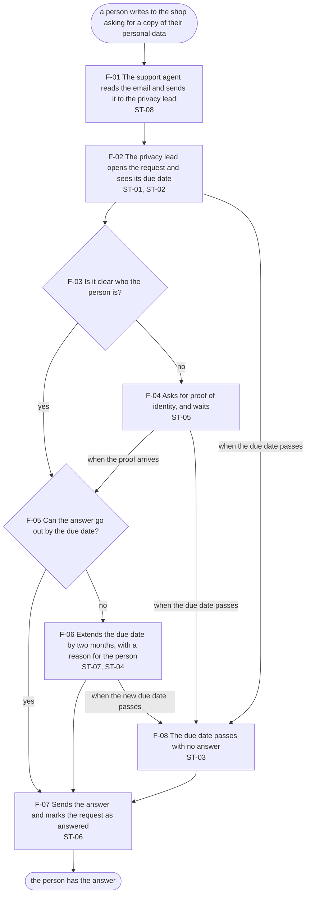

# Handoff: Request

Written by `npm run handoff` from `spec/screens/request.md` and the files it cites. Do not edit it: change the spec and run it again.

## The screen

- Template: detail-page (ai-ready-design-system, `contracts/detail-page.md`)
- Used by: Privacy lead (R-01), Support agent (R-02)
- Goals: Answer every request within the legal time (G-01); See first what needs action (G-02); Show later what was done, by whom and when (G-03); Hand a request on, and know it reached the privacy lead (G-04)
- Never shows: €, fee, price

## Flow: Answer a request

From `spec/flows/answer-a-request.md`. Starts when a person writes to the shop asking for a copy of their personal data. Each box names the states of this screen it lands on.

## Rules

Each rule is a requirement. Its sources say why, so a change upstream finds this screen.

| ID | Rule | Sources |
|---|---|---|
| BR-01 | The due date is one month after the day the request reached the shop, not the day the privacy lead opened it. | PRIV-01, Q-02 |
| BR-02 | The privacy lead can extend the due date once, before it passes, by two more months, and only after writing the reason that goes into the letter to the person. | PRIV-02, PRIV-03, D-03, D-04 |
| BR-03 | A request past its due date and not answered is overdue, and says so until someone closes it. | PRIV-01, D-02 |
| BR-04 | The privacy lead marks a request as answered with the date the answer was sent. The product sends nothing to the person. | PRIV-04, D-01 |
| BR-05 | The privacy lead asks for proof of identity only with a reasonable doubt, written down. The due date does not move while the lead waits. | PRIV-07, D-05, Q-01 |
| BR-06 | Answering is free, and the product never charges for a copy. No screen shows a fee or a price. | PRIV-06, PRIV-08 |
| BR-07 | A request is due soon from 7 days before its due date. | D-06, G-02 |
| BR-08 | A support agent sees who has the request, and nothing they can change. | R-02 |

## States

When two states could apply, the first one wins.

| ID | State | When | Status | Actions |
|---|---|---|---|---|
| ST-06 | Answered | the privacy lead marked the request as answered | positive: "Answered on {answered}" | none |
| ST-08 | Support agent's view | a support agent opens a request that is not answered | none: "With the privacy lead" | none |
| ST-07 | Extending, no reason yet | the privacy lead clicked Extend and has not written the reason | info: "Due on {due}" | Extend (primary, disabled), Cancel (tertiary) |
| ST-03 | Overdue | not answered, and today is after the due date | critical: "Overdue since {due}" | Mark as answered (primary) |
| ST-05 | Waiting for proof of identity | the privacy lead asked for proof of identity and has not received it | none: "Waiting for proof of identity" | Proof received (primary), Mark as answered (secondary) |
| ST-02 | Due soon | not answered, and the due date is 7 days away or less | warning: "Due {in}" | Mark as answered (primary), Extend (secondary) unless already extended, Ask for proof of identity (tertiary) |
| ST-04 | Extended | the privacy lead extended the due date, and it is more than 7 days away | info: "Extended to {due}" | Mark as answered (primary), Ask for proof of identity (tertiary) |
| ST-01 | Open | none of the above | info: "Due on {due}" | Mark as answered (primary), Extend (secondary), Ask for proof of identity (tertiary) |

## Acceptance tests

One per example in the spec. `npm run behaviour` runs every one of them against the built screen.

- **E-01.** Given a request received 3 Nov 2026, opened by the privacy lead on 10 Nov 2026. Then the due date is 3 Dec 2026, the screen is in ST-01 Open, and it offers Mark as answered, Extend, Ask for proof of identity.
- **E-02.** Given a request received 3 Nov 2026, opened by the privacy lead on 28 Nov 2026. Then the due date is 3 Dec 2026, the screen is in ST-02 Due soon, and it offers Mark as answered, Extend, Ask for proof of identity.
- **E-03.** Given a request received 3 Nov 2026, opened by the privacy lead on 4 Dec 2026. Then the due date is 3 Dec 2026, the screen is in ST-03 Overdue, and it offers Mark as answered.
- **E-04.** Given a request received 3 Nov 2026, extended on 20 Nov 2026, opened by the privacy lead on 25 Nov 2026. Then the due date is 3 Feb 2027, the screen is in ST-04 Extended, and it offers Mark as answered, Ask for proof of identity.
- **E-05.** Given a request received 3 Nov 2026, proof asked on 12 Nov 2026, opened by the privacy lead on 20 Nov 2026. Then the due date is 3 Dec 2026, the screen is in ST-05 Waiting for proof of identity, and it offers Proof received, Mark as answered.
- **E-06.** Given a request received 3 Nov 2026, answered on 28 Nov 2026, opened by the privacy lead on 10 Dec 2026. Then the due date is 3 Dec 2026, the screen is in ST-06 Answered, and it offers no action.
- **E-07.** Given a request received 3 Nov 2026, opened by the privacy lead on 20 Nov 2026, with the extend dialog open and no reason written. Then the due date is 3 Dec 2026, the screen is in ST-07 Extending, no reason yet, and it offers Extend, Cancel.
- **E-08.** Given a request received 3 Nov 2026, opened by the support agent on 20 Nov 2026. Then the due date is 3 Dec 2026, the screen is in ST-08 Support agent's view, and it offers no action.
- **E-09.** Given a request received 31 Jan 2026, opened by the privacy lead on 10 Feb 2026. Then the due date is 28 Feb 2026, the screen is in ST-01 Open, and it offers Mark as answered, Extend, Ask for proof of identity.
- **E-10.** Given a request received 3 Nov 2026, extended on 20 Nov 2026, opened by the privacy lead on 30 Jan 2027. Then the due date is 3 Feb 2027, the screen is in ST-02 Due soon, and it offers Mark as answered, Ask for proof of identity.
- **E-11.** Given a request received 3 Nov 2026, extended on 20 Nov 2026, opened by the privacy lead on 5 Feb 2027. Then the due date is 3 Feb 2027, the screen is in ST-03 Overdue, and it offers Mark as answered.
- **E-12.** Given a request received 3 Nov 2026, proof asked on 12 Nov 2026, opened by the privacy lead on 5 Dec 2026. Then the due date is 3 Dec 2026, the screen is in ST-03 Overdue, and it offers Mark as answered.
- **E-13.** Given a request received 3 Nov 2026, opened by the privacy lead on 3 Dec 2026. Then the due date is 3 Dec 2026, the screen is in ST-02 Due soon, and it offers Mark as answered, Extend, Ask for proof of identity.
- **E-14.** Given a request received 3 Nov 2026, answered on 28 Nov 2026, opened by the support agent on 10 Dec 2026. Then the due date is 3 Dec 2026, the screen is in ST-06 Answered, and it offers no action.

## Decisions behind it

- **D-01.** The product does not send answers to the person. The privacy lead sends them from the shop's own email and marks the request as answered, with the date sent.
- **D-02.** A request past its due date stays at the top of the list, marked "overdue", until someone closes it. It never leaves the list on its own.
- **D-03.** The Extend button stays disabled until the lead writes the reason, which goes into the letter to the person.
- **D-04.** A request is extended once, always by the full two months.
- **D-05.** While the lead waits for proof of identity, the due date does not move.
- **D-06.** A request is "due soon" from 7 days before its due date.

## Open questions

Built as "meanwhile" says. When the answer comes, the spec changes in one place, and this handoff with it.

- **Q-01.** Does the month stop while the shop waits for proof of identity (PRIV-07)? Meanwhile, the due date does not move (D-05).
- **Q-02.** How is "one month" counted when the next month has no such day, such as a request received on 31 January? Meanwhile, the due date is the last day of the next month.

## Official rules

- **PRIV-01** (GDPR Art. 12(3), to confirm): Answer a request about personal data (access, correction, erasure, restriction, portability, objection) without undue delay, and within one month of receiving it at the latest.
- **PRIV-02** (GDPR Art. 12(3), to confirm): The month can be extended by two more months when needed, given how complex the requests are and how many there are.
- **PRIV-03** (GDPR Art. 12(3), to confirm): The person must be told of an extension within one month of the request, with the reasons.
- **PRIV-04** (GDPR Art. 12(3), to confirm): A request made electronically is answered electronically where possible, unless the person asks otherwise.
- **PRIV-06** (GDPR Art. 12(5), to confirm): Answering is free. Only for a request that is manifestly unfounded or excessive, in particular repetitive, may the shop charge a reasonable fee or refuse, and the shop must be able to show why.
- **PRIV-07** (GDPR Art. 12(6), to confirm): Only with reasonable doubts about who made the request may the shop ask for more information, and only what is needed to confirm identity.
- **PRIV-08** (GDPR Art. 15(3), to confirm): The person gets a copy of their personal data. Further copies may cost a reasonable fee based on administrative costs.
